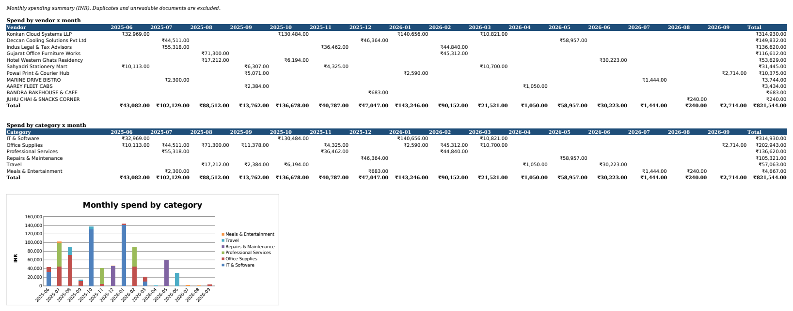
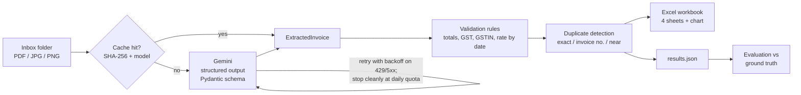

# Invoice Data Extraction & Automation Tool

Reads PDF invoices and receipt photos with Gemini, pulls out vendor, GSTIN, date, line items, totals and GST into an Excel workbook, cross-checks every total and tax, flags duplicates and mismatches for review, and summarises monthly spending by vendor and category.


> All documents in this repo are **synthetic**: fictional vendors, randomly generated GSTINs, and a "SYNTHETIC TEST DOCUMENT" footer on every page. On the Gemini free tier Google may use inputs to improve its products, so no real invoices were ever sent.

## What it looks like

Output workbook from the real run below, rendered with LibreOffice. Rows that need review are highlighted.

**Invoices** (one row per document, status and reason codes up front)


**Flags for Review** (one row per issue, in plain English, with the related file for duplicates)


**Monthly Summary** (vendor x month, category x month and a chart; duplicates excluded)


Terminal output of the live run (quickstart command; 30 API calls, the byte-identical duplicate came from the cache; transient 503/429s were retried automatically):

```text
[3/31] inv_003.pdf: sending to gemini-3.5-flash-lite...
  503 from Gemini; retry 1/3 in 5s
...
31 documents -> out\out.xlsx  (OK 16, needs review 15, failed 0)
API calls: 30, cached: 1
  CGST_SGST_UNEQUAL           1
  DUP_EXACT                   1
  DUP_INVOICE_NO              1
  DUP_NEAR                    1
  GSTIN_INVALID               2
  GST_RATE_INVALID_FOR_DATE   2
  LINE_SUM_MISMATCH           2
  MISSING_FIELD               1
  TAX_TYPE_MISMATCH           2
  TOTAL_MISMATCH              2
```

## Architecture



The model only **transcribes**. Every check is deterministic Python, so each flag has a reason you can reproduce by hand.

## Results

Run on 2026-11-14 with `gemini-3.5-flash-lite` (free tier) over the 31 synthetic documents in `samples/`: 21 text PDFs and 10 scanned-looking PDFs or receipt photos, 16 clean and 15 with a planted error or duplicate. Reproduce with the quickstart below; the numbers come from `eval/results.md`.

**Flags vs planted errors: 15 of 15 caught, 0 false alarms**

| Reason code | Planted | Caught | False alarms |
|---|---|---|---|
| LINE_SUM_MISMATCH | 2 | 2 | 0 |
| TOTAL_MISMATCH | 2 | 2 | 0 |
| TAX_TYPE_MISMATCH | 2 | 2 | 0 |
| CGST_SGST_UNEQUAL | 1 | 1 | 0 |
| GSTIN_INVALID | 2 | 2 | 0 |
| GST_RATE_INVALID_FOR_DATE | 2 | 2 | 0 |
| MISSING_FIELD | 1 | 1 | 0 |
| DUP_EXACT / DUP_INVOICE_NO / DUP_NEAR | 3 | 3 | 0 |

**Field-level extraction accuracy** (exact match after normalisation; amounts within ₹0.01)

| Field | All 31 | Text PDF (21) | Scanned / photo (10) |
|---|---|---|---|
| Vendor name, GSTINs, invoice no., date | 100% | 100% | 100% |
| Subtotal, CGST, SGST, IGST, round-off, total | 100% | 100% | 100% |
| Line items: count, description, HSN/SAC, qty, price, amount, GST rate | 100% (67 lines) | 100% | 100% |
| Document type (invoice vs receipt) | 100% (31/31) | 100% | 100% |
| Category (from a fixed list) | 87% (27/31) | 81% (17/21) | 100% |

The 4 category misses are judgement calls, not misreads. They are a courier/printing shop (labelled *Other*) and an AC purchase (labelled *Repairs & Maintenance*) that the model put under *Office Supplies*. Full per-field table: [eval/results.md](eval/results.md).

Honest caveats:
- **This is a second run, after tuning on the same set.** In the first run, `document_type` was 83% (25/30): every thermal receipt headed "TAX INVOICE" was called an invoice. I then clarified the receipt definition in the prompt (prompt v2) and added a cash-memo receipt with no GSTIN. The 100% above is from that second run on the same documents, so treat it as optimistic. Everything else was identical across both runs.
- 31 synthetic documents is a small set, and they're cleaner than real-world scans.
- The planted errors test the validation logic end to end, so 100% recall says the rules work when extraction is right. It doesn't mean every real-world error will be caught.

## Quickstart

Needs [uv](https://docs.astral.sh/uv/) (it installs Python 3.12 for you). The commands work in PowerShell and in macOS/Linux shells.

```bash
git clone https://github.com/washedhunter/invoice-extraction-automation.git
cd invoice-extraction-automation
uv sync
cp .env.example .env        # then put your key from https://aistudio.google.com in .env
uv run invoice-tool process samples --out out/out.xlsx --json-out out/results.json
uv run invoice-eval --results out/results.json
```

**No API key?** Replay the recorded real responses from the run above:

```bash
uv run invoice-tool process samples --replay samples/recorded --out out/demo.xlsx
```

**Watch an inbox folder** (reprocesses when files arrive; already-seen files come from the cache):

```bash
uv run invoice-tool process inbox --out out/inbox.xlsx --watch
```

Other commands: `uv run invoice-synth --out samples --clean` regenerates the synthetic set (text PDFs and ground truth are byte-identical; the scanned images can differ slightly with other Pillow/pdfium versions, which would make `samples/recorded` miss them), and `uv run pytest` runs the offline tests. `--replay` exits with code 4 if any file has no recorded response, and `invoice-eval --strict` exits with code 1 on any miss, false alarm or unprocessed file; CI uses both. If the daily free-tier quota runs out mid-run, the tool writes what it has, exits with code 3, and resumes from the cache on the next run.

## Project structure

```
config/settings.toml      model, tolerances, categories, required fields (env-overridable: INVOICE_*)
config/gst_rates.toml     GST slabs by date (pre / post GST 2.0, 22 Sep 2025)
src/invoice_tool/
  cli.py                  `invoice-tool process` (+ --watch, --replay, --json-out)
  extractor.py            the only module that calls Gemini: schema, prompt, retries, quota handling
  cache.py                SHA-256 keyed result cache; same format as samples/recorded
  schema.py               Pydantic models (Gemini response schema = ground-truth format)
  rules.py  gstin.py      validation rules with reason codes; GSTIN checksum
  duplicates.py           exact / same invoice no. / near-duplicate detection
  summary.py  excel.py    pandas pivots; openpyxl workbook with formats, filters, chart
  pipeline.py  watch.py   orchestration; inbox watcher
  evaluate.py             field accuracy + flag precision/recall vs ground truth
  synth/                  synthetic invoice generator (5 layouts, scan effects, planted errors)
samples/                  31 synthetic documents, ground_truth/*.json, recorded/ Gemini responses
eval/results.md           evaluation report from the live run
tests/                    87 offline tests (Gemini is mocked, network blocked)
docs/DECISIONS.md         why each choice was made, and what else was considered
```

## Design decisions and trade-offs

Details in [docs/DECISIONS.md](docs/DECISIONS.md). In short:

- **LLM transcribes, Python judges.** The prompt tells Gemini to copy printed values even when they're wrong. Arithmetic, GST rules and duplicates are deterministic code, so they're testable, explainable and free.
- **Structured output plus Pydantic re-validation.** The API ignores some schema constraints, so every response is validated again, and the category list from config is injected as an enum.
- **Synthetic data with planted errors.** It gives exact ground truth and keeps real invoices off a free tier that may train on inputs. An "oracle" test runs the validators on the ground truth to separate rule bugs from extraction errors.
- **Cache by file hash.** Re-runs and duplicate files never re-bill; a run interrupted by the daily quota resumes the next day.
- **Model: `gemini-3.5-flash-lite`.** `gemini-3.8-flash` timed out on every request from a free-tier key on the day of the run. `gemini-3.6-flash` allows only 20 requests a day on the free tier, so it can't cover the 30 unique files in one day. The model is one line in config.

## Limitations and next steps

- The GST rate check is **slab-level** (was this rate a GST slab on that date?), not HSN-specific, and it doesn't model item-specific exceptions.
- Intra- vs inter-state is decided from the GSTIN state codes, so it needs both GSTINs. Place-of-supply special cases (hotels, events) aren't modelled.
- `document_type` matters: receipts have looser required fields. It's correct on this set only after a prompt fix tuned on the same set (see Results).
- The summary is INR-only; documents in other currencies are listed on the sheet but not converted.
- Category is a judgement call; a few labelled examples in the prompt, or a per-vendor category memory, would help.
- Synthetic scans are mild (small skew, noise, blur). Real phone photos with shadows, folds and handwriting need their own test set.
- Next: multi-page invoices with continuation tables, a per-vendor rules file, a reviewer workflow that reads "Reviewer Notes" back in, and a comparison across models when quota allows.

## License

MIT, see [LICENSE](LICENSE).
